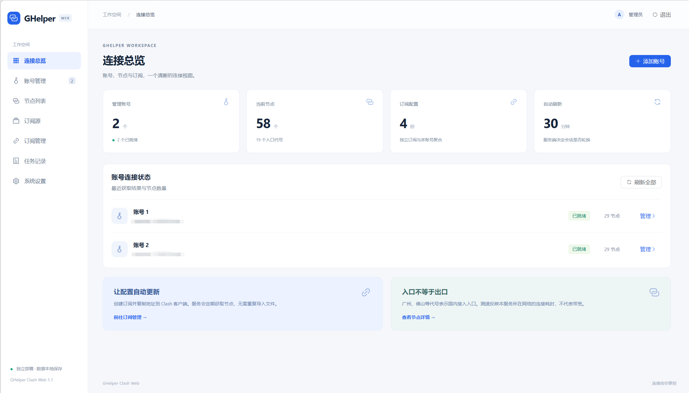

# GHelper Clash Web

把 GHelper 浏览器扩展的 HTTPS 代理节点，变成一条会自动更新的 Clash / mihomo 订阅地址。

服务端自己拿 token 向上游要节点、测延迟、按需过滤去重，客户端只管订阅；运行时不依赖浏览器和 PowerShell。



## 功能

- **多账号管理**：批量导入 token，自动读取账号资料，按计划刷新节点池（默认 30 分钟）。
- **真实测速**：内置 mihomo 内核，用节点真实跑一次请求，而不是只探端口。
- **外部订阅源**：导入机场的 Clash YAML、base64 订阅或链接列表，和 GHelper 节点合成一条订阅。
- **订阅策略**：可去除不可用节点、按延迟上限过滤、每个国家只留最快的 N 个、去除重复节点。
- **一键导出**：生成 `clash_url`（完整配置）和 `proxies_url`（仅节点，给 `proxy-providers` 用）。

## 部署

镜像发布在 `ghcr.io/yz0812/ghelp2api:latest`，同时提供 `amd64` 和 `arm64`。

```sh
docker run -d --name ghelper -p 127.0.0.1:8000:8000 \
  -v ghelper-data:/data \
  -e ADMIN_USERNAME=admin \
  -e ADMIN_PASSWORD='至少9位密码' \
  -e ADMIN_API_KEY='至少32位随机串' \
  -e ENCRYPTION_KEY="$(python -c 'import base64,secrets;print(base64.urlsafe_b64encode(secrets.token_bytes(32)).decode())')" \
  -e PUBLIC_BASE_URL=https://你的域名 \
  -e COOKIE_SECURE=true \
  ghcr.io/yz0812/ghelp2api:latest
```

容器以 UID `10001` 运行，数据固定写 `/data`。必须**单实例、单 worker**——刷新串行和测速并发控制都在进程内，没有 Redis 或外部数据库。

更新镜像：`docker pull` 后重建容器，数据库迁移在启动时自动执行。升级前备份数据卷和 `.env`。

本地开发（Python 3.12–3.14、Node.js 24）：

```powershell
python -m venv .venv
.\.venv\Scripts\python -m pip install -r requirements-dev.txt
.\.venv\Scripts\python -m app.cli init          # 生成 .env，随机密码，不覆盖已有配置
npm --prefix frontend ci && npm --prefix frontend run build
.\.venv\Scripts\python -m uvicorn app.main:create_app --factory --host 127.0.0.1 --port 8000 --workers 1
```

访问 http://localhost:8000 。跑前端热更新用 `npm --prefix frontend run dev`，`/api` 和 `/sub` 会转发到 8000。

### 环境变量

| 变量 | 说明 |
|---|---|
| `ADMIN_USERNAME` | 管理员账号，默认 `admin` |
| `ADMIN_PASSWORD` | 至少 9 位 |
| `ADMIN_API_KEY` | 至少 32 位，程序调用管理接口用 |
| `ENCRYPTION_KEY` | Fernet 密钥，必须和数据库一起备份，**不能随意更换** |
| `PUBLIC_BASE_URL` | 对外访问地址，用来拼接订阅链接，不能保留 localhost |
| `COOKIE_SECURE` | HTTPS 部署设为 `true` |
| `DATA_DIR` | 本地默认 `./data`，容器内固定 `/data` |
| `SCHEDULER_ENABLED` | 默认 `true`，测试环境可关闭自动刷新 |
| `API_HOSTS` / `EXTENSION_VERSION` | 上游域名与请求版本，一般不用改 |

## 使用流程

1. **账号管理** → 每行一个 32 位 token，或 `名称,token`，也可导入提取脚本的 JSON。
2. 点“刷新全部”，等节点拉回来。
3. **节点列表** → 选账号/入口，按需测速。
4. **订阅源**（可选）→ 粘贴机场订阅地址，保存即拉取；之后可“检测失效”并一键禁用或删除失效源。
5. **订阅管理** → 勾选账号与订阅源，设置过滤/去重/每国节点数，生成订阅。
6. 把 `clash_url` 填进客户端，建议 30–60 分钟更新一次。

## 接口

认证用 `Authorization: Bearer <ADMIN_API_KEY>`。完整文档见 `/api/docs`。

```sh
# 导入账号
curl -X POST http://localhost:8000/api/v1/accounts/import \
  -H "Authorization: Bearer $KEY" -H "Content-Type: application/json" \
  -d '{"accounts":[{"name":"账号 A","token":"<32位token>"}]}'

# 刷新全部，返回 job_id，用 /api/v1/jobs/<job_id> 查进度
curl -X POST http://localhost:8000/api/v1/accounts/all/refresh -H "Authorization: Bearer $KEY"

# 直接取整套 Clash 配置；format=proxies 只取节点
curl "http://localhost:8000/api/v1/config/clash?account_ids=<ID>&format=full" \
  -H "Authorization: Bearer $KEY" -o ghelper-clash.yaml

# 创建订阅，返回 clash_url / proxies_url
curl -X POST http://localhost:8000/api/v1/subscriptions \
  -H "Authorization: Bearer $KEY" -H "Content-Type: application/json" \
  -d '{"name":"统一订阅","account_ids":["<ID>"],"source_ids":[],"exclude_failed":true,"dedupe":true,"max_per_country":3}'
```

订阅地址靠独立随机密钥授权，不需要登录；轮换密钥或删除订阅后旧地址立即失效。接进已有的 mihomo 配置：

```yaml
proxy-providers:
  ghelper:
    type: http
    url: "https://你的域名/sub/<订阅密钥>/proxies.yaml"
    path: ./providers/ghelper.yaml
    interval: 1800
    health-check:
      enable: true
      url: https://www.gstatic.com/generate_204
      interval: 300
proxy-groups:
  - name: GHelper
    type: select
    use: [ghelper]
```

## 口径说明

- **延迟 = 服务所在网络**经该代理访问检测地址的耗时，不是带宽，也不是你本机的延迟。国内入口代号（广州、佛山等）只是接入点，不代表出口地区。
- 上游会话约 180 分钟回收且不可强刷。超过 150 分钟后进入每 5 分钟探测，`pk` 变化才算换池成功。
- 上游失败时只输出 60 分钟内确认过的快照；一个账号都没有节点时返回 HTTP 503，绝不输出空配置。
- 过滤只排除**明确失败**或**明确超延迟**的节点；本轮没测到的保持未知并保留，后台会继续补齐。
- 服务不执行 PAC 脚本，也不请求上游下发的测速地址；节点代理证书沿用 `skip-cert-verify: true`，上游 API 与测速目标仍校验证书。

## Token 提取脚本（Windows）

Chrome / Edge 中已登录 GHelper 扩展时，可直接从本地存储读出 token，不改动浏览器数据。

```powershell
.\.venv\Scripts\python -m pip install -r requirements-local.txt
.\.venv\Scripts\python scripts\extract_browser_tokens.py                    # 脱敏显示
.\.venv\Scripts\python scripts\extract_browser_tokens.py --output tokens-export.json   # 导出后到管理台导入
.\.venv\Scripts\python scripts\extract_browser_tokens.py --browser edge --profile "Profile 1" --show-secrets
```

只读取当前生效的 token，快照不稳定或损坏时报错退出，不输出历史凭证。退出码：0 成功，1 未找到，2 失败。

## 开发与发版

```powershell
.\.venv\Scripts\python -m pytest -q
.\.venv\Scripts\python -m ruff check app scripts tests migrations
npm --prefix frontend run build
```

CI 会跑 Windows/Linux × Python 3.12/3.14 测试、前端构建与 Playwright 端到端测试、容器启动与数据卷持久化检查，然后构建双架构镜像。PR 只构建，主分支和 `v*` 标签自动推送。

**发版**：改 `VERSION`（当前 `V1.2.1`）后提交推送即可，不要在工作流里写死版本号。镜像会同时打上 `VERSION`、`latest` 和 `sha-<commit>`。

不要把 `.env`、数据库、token 导出文件、真实节点 YAML 提交到仓库。反向代理日志记得隐藏 `/sub/` 路径里的密钥。
