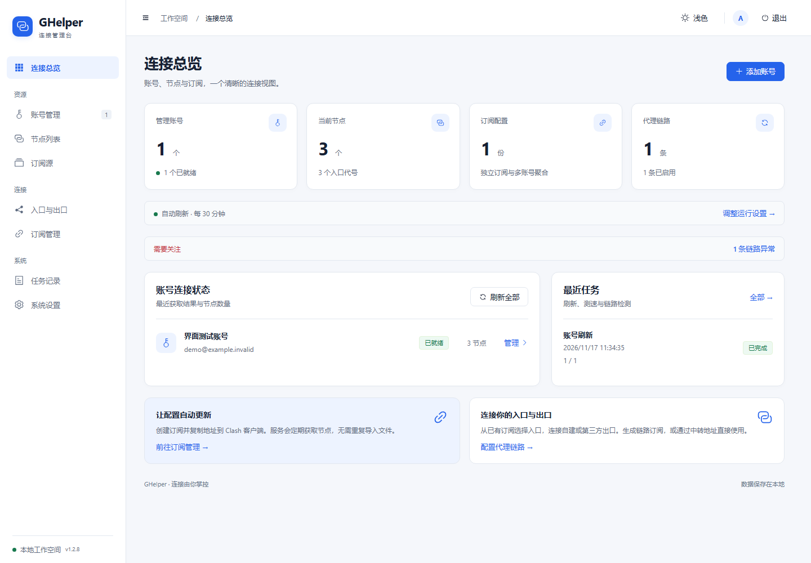
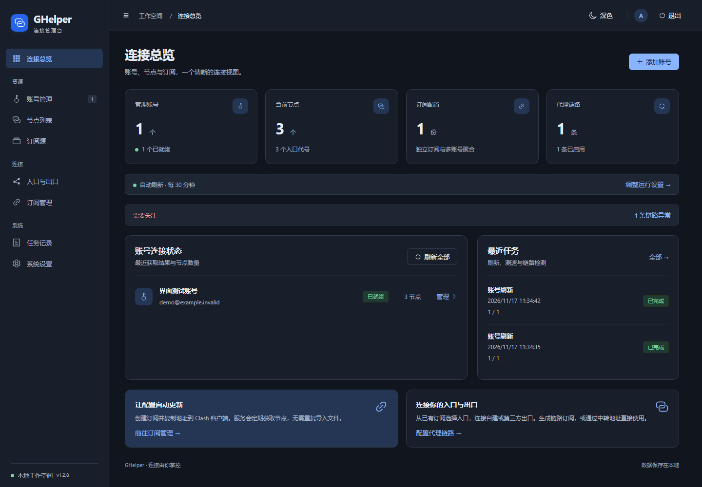

# GHelper Clash Web

把 GHelper 浏览器扩展的 HTTPS 代理节点，变成一条会自动更新的 Clash / mihomo 订阅地址。

服务端自己拿 token 向上游要节点、测延迟、按需过滤去重，客户端只管订阅；运行时不依赖浏览器和 PowerShell。



<details>
<summary>深色主题预览（截图使用测试数据）</summary>



</details>

## 功能

- **多账号管理**：批量导入 token，自动读取账号资料，按计划刷新节点池（默认 30 分钟）。
- **真实测速**：内置 mihomo 内核，用节点真实跑一次请求，而不是只探端口。
- **外部订阅源**：导入机场的 Clash YAML、base64 订阅或链接列表，和 GHelper 节点合成一条订阅。
- **订阅策略**：可去除不可用节点、按延迟上限过滤、每个国家只留最快的 N 个、去除重复节点。
- **一键导出**：生成 `clash_url`（完整配置）和 `proxies_url`（仅节点，给 `proxy-providers` 用）。
- **统一管理台**：浅色、深色与跟随系统主题，支持折叠侧栏和手机导航；账号与订阅源可搜索筛选，复杂配置在居中弹窗中完成，长表单支持内部滚动。

外观可通过右上角的主题菜单或“系统设置 → 外观偏好”切换，偏好保存在当前浏览器。资源卡片上的“更多”菜单包含生成订阅、预览下载、轮换认证和删除等操作；连接信息支持分项复制。

## 部署

### 入口、出口与链路

在“链式”页面点击“可视化新建”，按顺序组合 2–5 跳，每条链路最多配置三条主备路径。第一跳可使用入口候选池、订阅固定节点或已保存代理；后续跳使用固定订阅节点或已保存代理。中间节点支持拖拽和按钮排序，编辑页也能直接创建入口池与代理。旧两跳表单仍可使用，旧链路的 ID、端口、认证和订阅地址保持不变。

入口候选池提供最快优先、指定节点、稳定优先（毫秒容差）和主备优先（明确候选顺序）。指定节点失效时不会按名称替换。主备路径按优先级选择，主路径恢复后回切。默认锁定相同出口，解除后不同路径可使用不同出口，切换时出口 IP 可能改变。后续跳暂不支持依赖 UDP 的 Hysteria2、QUIC、KCP 传输。

保存前会验证引用及内核配置；并发修改通过配置版本拒绝覆盖。模板仅保存节点引用与策略，不包含端口、认证或检测历史；复制链路会生成新端口和认证，副本默认停用。紧凑视图支持批量检测、启停、监控、删除和生成／合入订阅，逐项报告失败原因。

候选节点通过“选择节点”独立弹窗配置，支持搜索、跨页多选、测速已选或全部候选、按延迟排序。测速完成后自动更新结果；点击“确认选择”带回表单，取消保留原选择。弹窗测速为入口节点延迟，链路运行时再检测经过出口的完整路径。

出口列表提供“测速”，从服务器直连出口验证代理可用性和延迟；必须经入口访问的出口应使用链路检测。传统两跳卡片检测最长约 40 秒。新版“检测草稿”“诊断与历史”使用独立内核，支持取消、任务记录、完整路径及累计前缀诊断、出口 IP 查询；预算 120 秒，全局最多并发两项，不修改线上选路。累计前缀延迟不是相邻节点间延迟，失败阶段只用于提示可能受阻的位置。

新建可视化链路默认每 300 秒自动监控，旧链路升级后默认关闭。历史保留 30 天，可查看 24 小时／7 天／30 天趋势及故障、恢复、路径切换和出口 IP 事件。可用率只统计有明确结果的自动监控样本，缺测不算成功；IP 查询失败不直接判定链路不可用。所有结果来自服务器，不能代表客户端原生链路的运行情况。
出口支持 HTTP、HTTPS、SOCKS5，可通过表单或粘贴一个 YAML 节点导入；密码加密保存，编辑时留空保留原密码。
入口仅使用来源订阅中符合筛选条件的普通节点。多选用于限定候选范围，每条链路独立决定如何使用这些候选：自动模式每 5 分钟检测经过出口的完整链路，选择延迟最低的可用入口（不是下载带宽测速）；指定模式只使用所选的一个节点，失效时不会切换到其他节点。已有链路默认保留自动模式，旧单节点配置继续兼容。

链路卡片展示入口使用方式、指定节点和服务器中转实际使用的入口，并每 5 秒刷新状态。“检测链路”在中转运行时直接检测实际代理组，自动模式会据此重新择优；中转未运行时只返回服务器侧检测结果。客户端原生订阅独立执行选路，其当前入口请在客户端查看；修改指定入口后需更新客户端订阅。

链路可以单独生成订阅，也能在“订阅管理”中合入已有订阅。完整配置默认使用客户端执行的原生多跳链路，
也可选择服务器中转；仅节点地址 `proxies.yaml` 中的链路始终使用带认证的服务器中转节点。
中转关闭或不可用的链路不会进入仅节点导出；所有输出均不可用时返回 503。
页面卡片直接显示最近检测结果；需要逐层排查或历史记录时使用“诊断与历史”。

“连接信息”提供代理域名、端口和独立账号密码，同一端口支持 HTTP 与 SOCKS5，首版转发 TCP 流量。
在“系统设置”中可保存“代理对外域名或 IP”，供所有未单独指定域名的链路使用，保存后立即生效。
系统代理对外地址默认使用 `proxy.accsunny.com`，可在系统设置中修改。
地址优先级：链路单独配置 > 系统代理对外地址 > `PUBLIC_BASE_URL` 的主机名。
只填写域名或 IP，不包含协议、端口或路径；使用 Cloudflare 时，代理域名应设为“仅 DNS（灰云）”。
域名必须解析到部署服务器，代理端口需直接转发到容器；网站的 HTTP 反向代理不会自动转发这些端口。
默认分配范围为 `20000–20099`，用 `PROXY_PORT_START` / `PROXY_PORT_END` 调整，并同步修改端口映射：

```sh
# 在下方 docker run 命令中增加以下端口参数：
-p 20000-20099:20000-20099/tcp
```

本地部署需要可用的 Mihomo，可通过 `MIHOMO_BIN` 指定；Docker 镜像已内置。
服务启动时恢复监听，配置修改时重建代理进程，已有连接可能短暂中断。
停用、删除或轮换认证立即应用；进程启动失败时关闭监听并显示错误，后台退避重试。
出口信息和代理认证与现有数据一样依赖 `ENCRYPTION_KEY`，升级时需保留原密钥与数据卷。

镜像发布在 `ghcr.io/yz0812/ghelp2api:latest`，同时提供 `amd64` 和 `arm64`。

```sh
docker run -d --name ghelper -p 127.0.0.1:8000:8000 \
  -v ghelper-data:/data \
  -e ADMIN_USERNAME=admin \
  -e ADMIN_PASSWORD='至少5位密码' \
  -e ADMIN_API_KEY='至少32位随机串' \
  -e ENCRYPTION_KEY="$(python -c 'import base64,secrets;print(base64.urlsafe_b64encode(secrets.token_bytes(32)).decode())')" \
  -e PUBLIC_BASE_URL=https://你的域名 \
  -e COOKIE_SECURE=true \
  ghcr.io/yz0812/ghelp2api:latest
```

容器以 UID `10001` 运行，数据固定写 `/data`。必须**单实例、单 worker**——刷新串行和测速并发控制都在进程内，没有 Redis 或外部数据库。

更新镜像：`docker pull` 后重建容器，数据库迁移在启动时自动执行。升级前备份数据卷和 `.env`。

本地开发（Python 3.12–3.14、Node.js 24）：

```powershell
python -m venv .venv
.\.venv\Scripts\python -m pip install -r requirements-dev.txt
.\.venv\Scripts\python -m app.cli init          # 生成 .env，随机密码，不覆盖已有配置
npm --prefix frontend ci && npm --prefix frontend run build
.\.venv\Scripts\python -m uvicorn app.main:create_app --factory --host 127.0.0.1 --port 8000 --workers 1
```

访问 http://localhost:8000 。跑前端热更新用 `npm --prefix frontend run dev`，`/api` 和 `/sub` 会转发到 8000。

### 环境变量

| 变量 | 说明 |
|---|---|
| `ADMIN_USERNAME` | 管理员账号，默认 `admin` |
| `ADMIN_PASSWORD` | 至少 5 位 |
| `ADMIN_API_KEY` | 至少 32 位，程序调用管理接口用 |
| `ENCRYPTION_KEY` | Fernet 密钥，必须和数据库一起备份，**不能随意更换** |
| `PUBLIC_BASE_URL` | 对外访问地址，用来拼接订阅链接，不能保留 localhost |
| `COOKIE_SECURE` | HTTPS 部署设为 `true` |
| `DATA_DIR` | 本地默认 `./data`，容器内固定 `/data` |
| `SCHEDULER_ENABLED` | 默认 `true`，测试环境可关闭自动刷新 |
| `API_HOSTS` / `EXTENSION_VERSION` | 上游域名与请求版本，一般不用改 |

## 使用流程

1. **账号管理** → 每行一个 32 位 token，或 `名称,token`，也可导入提取脚本的 JSON。
2. 点“刷新全部”，等节点拉回来。
3. **节点列表** → 选账号/入口，按需测速。
4. **订阅源**（可选）→ 粘贴机场订阅地址，保存即拉取；之后可“检测失效”并一键禁用或删除失效源。
5. **订阅管理** → 勾选账号与订阅源，设置过滤/去重/每国节点数，生成订阅。
6. 把 `clash_url` 填进客户端，建议 30–60 分钟更新一次。

## 接口

认证用 `Authorization: Bearer <ADMIN_API_KEY>`。完整文档见 `/api/docs`。

```sh
# 导入账号
curl -X POST http://localhost:8000/api/v1/accounts/import \
  -H "Authorization: Bearer $KEY" -H "Content-Type: application/json" \
  -d '{"accounts":[{"name":"账号 A","token":"<32位token>"}]}'

# 刷新全部，返回 job_id，用 /api/v1/jobs/<job_id> 查进度
curl -X POST http://localhost:8000/api/v1/accounts/all/refresh -H "Authorization: Bearer $KEY"

# 直接取整套 Clash 配置；format=proxies 只取节点
curl "http://localhost:8000/api/v1/config/clash?account_ids=<ID>&format=full" \
  -H "Authorization: Bearer $KEY" -o ghelper-clash.yaml

# 创建订阅，返回 clash_url / proxies_url
curl -X POST http://localhost:8000/api/v1/subscriptions \
  -H "Authorization: Bearer $KEY" -H "Content-Type: application/json" \
  -d '{"name":"统一订阅","account_ids":["<ID>"],"source_ids":[],"exclude_failed":true,"dedupe":true,"max_per_country":3}'
```

订阅地址靠独立随机密钥授权，不需要登录；轮换密钥或删除订阅后旧地址立即失效。接进已有的 mihomo 配置：

```yaml
proxy-providers:
  ghelper:
    type: http
    url: "https://你的域名/sub/<订阅密钥>/proxies.yaml"
    path: ./providers/ghelper.yaml
    interval: 1800
    health-check:
      enable: true
      url: https://www.gstatic.com/generate_204
      interval: 300
proxy-groups:
  - name: GHelper
    type: select
    use: [ghelper]
```

## 口径说明

- **延迟 = 服务所在网络**经该代理访问检测地址的耗时，不是带宽，也不是你本机的延迟。国内入口代号（广州、佛山等）只是接入点，不代表出口地区。
- GHelper 节点优先使用官方线路原名，通过 PAC 测速域名与官方接口精确关联；无法关联时显示“未识别出口”，不按入口推断出口。国家分类来自官方名称，未实测出口 IP。
- 管理台登录会话有效期 30 天，固定窗口不滑动续期，到期需重新登录。订阅地址不受此限制。
- 上游会话约 180 分钟回收且不可强刷。超过 150 分钟后进入每 5 分钟探测，`pk` 变化才算换池成功。
- 上游失败时只输出 60 分钟内确认过的快照；一个账号都没有节点时返回 HTTP 503，绝不输出空配置。
- 过滤只排除**明确失败**或**明确超延迟**的节点；本轮没测到的保持未知并保留，后台会继续补齐。
- 服务不执行 PAC 脚本，也不请求上游下发的测速地址；节点代理证书沿用 `skip-cert-verify: true`，上游 API 与测速目标仍校验证书。

## Token 提取脚本（Windows）

Chrome / Edge 中已登录 GHelper 扩展时，可直接从本地存储读出 token，不改动浏览器数据。

```powershell
.\.venv\Scripts\python -m pip install -r requirements-local.txt
.\.venv\Scripts\python scripts\extract_browser_tokens.py                    # 显示完整 token
.\.venv\Scripts\python scripts\extract_browser_tokens.py --mask             # 脱敏显示
.\.venv\Scripts\python scripts\extract_browser_tokens.py --output tokens-export.json   # 导出后到管理台导入
.\.venv\Scripts\python scripts\extract_browser_tokens.py --browser edge --profile "Profile 1"
```

只读取当前生效的 token，快照不稳定或损坏时报错退出，不输出历史凭证。退出码：0 成功，1 未找到，2 失败。

### 打包成 exe（给没有 Python 环境的机器用）

```powershell
pwsh -File scripts\build_extractor_exe.ps1 -Python .\.venv312\Scripts\python.exe
```

生成 `dist-exe\ghelper-token-extractor.exe`（单文件，约 9 MB），复制到其他 Windows 电脑即可运行，无需安装 Python。用法与脚本一致：

```powershell
.\ghelper-token-extractor.exe                                      # 双击或直接运行：显示完整 token
.\ghelper-token-extractor.exe --mask                               # 脱敏显示
.\ghelper-token-extractor.exe --output tokens-export.json          # 导出完整 token 后到管理台导入
.\ghelper-token-extractor.exe --browser edge --profile "Profile 1"
```

打包机需要 `requirements-local.txt` 和 `pyinstaller`。该 exe 会读取浏览器扩展的本地存储，部分杀毒软件可能误报，分发前请自行确认。

## 开发与发版

```powershell
.\.venv\Scripts\python -m pytest -q
.\.venv\Scripts\python -m ruff check app scripts tests migrations
npm --prefix frontend run build
```

CI 会跑 Windows/Linux × Python 3.12/3.14 测试、前端构建与 Playwright 端到端测试、容器启动与数据卷持久化检查，然后构建双架构镜像。

**发版**：工作流只在推送版本标签时触发，日常提交不会构建镜像。版本号只有一个来源——仓库根目录的 `VERSION`，写法与 git tag 完全相同（当前 `v1.3.0`）。后端在启动时读取该文件（`app/config.py`），前端通过 `/api/v1/settings` 拿到的 `version` 显示在侧栏与设置页，因此不需要在代码里再写一遍。

```sh
# 1. 改 VERSION 为目标版本并提交推送
# 2. 打同名 tag 并推送，触发构建
git tag v1.3.0 && git push origin v1.3.0
```

工作流会校验 tag 与 `VERSION` 是否一致，不一致直接失败，避免标签对不上。镜像标签全部由这一个版本号派生：`1.3.0`、`1.3`、`v1.3.0`、`latest`、`sha-<commit>`。也可在 Actions 页面手动触发 `workflow_dispatch`。

不要把 `.env`、数据库、token 导出文件、真实节点 YAML 提交到仓库。反向代理日志记得隐藏 `/sub/` 路径里的密钥。
