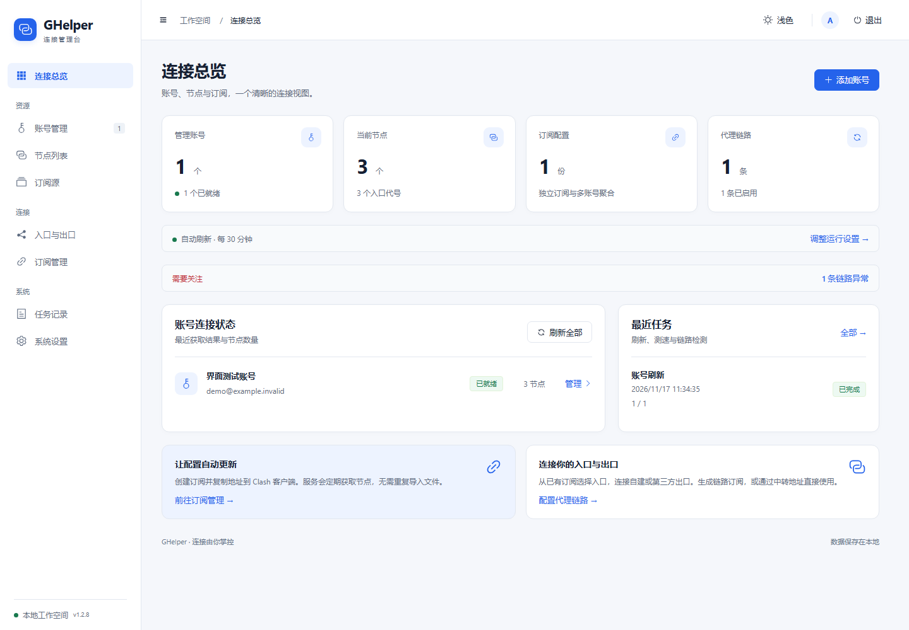
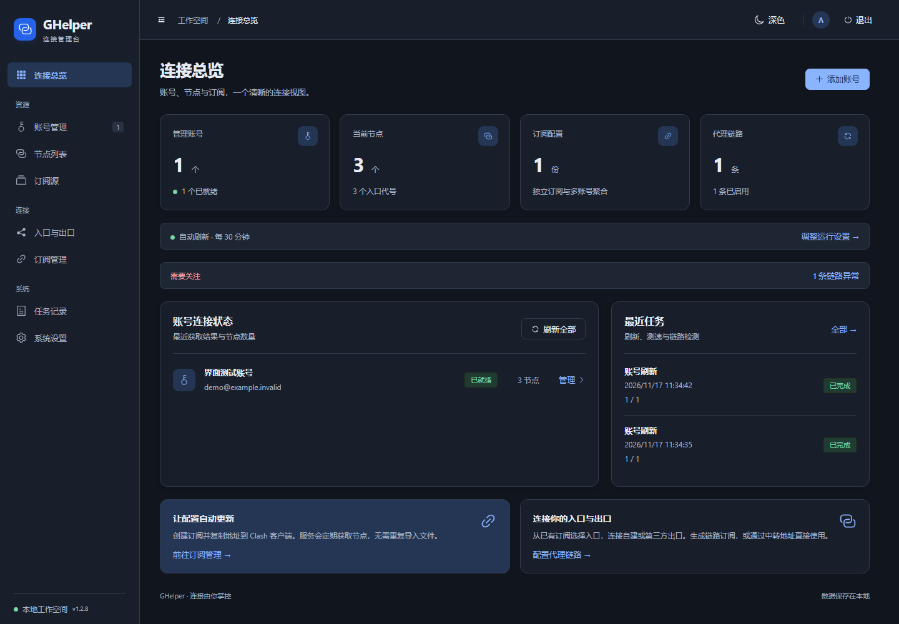

# GHelper 账号接入说明

把 GHelper 浏览器扩展的 HTTPS 代理节点转换为自动更新的 Clash / mihomo 订阅。服务端使用 token 获取节点、测速并过滤去重，运行时不依赖浏览器和 PowerShell。

## 界面预览



<details>
<summary>深色主题预览（截图使用测试数据）</summary>



</details>


## 账号管理

- **多账号管理**：批量导入 token，自动读取账号资料，按计划刷新节点池（默认 30 分钟）。

## 接入环境变量

| 变量 | 说明 |
|---|---|
| `API_HOSTS` / `EXTENSION_VERSION` | 上游域名与请求版本，一般不用改 |

## 使用流程

1. **账号管理** → 每行一个 32 位 token，或 `名称,token`，也可导入提取脚本的 JSON。
2. 点“刷新全部”，等节点拉回来。
3. **节点列表** → 选账号/入口，按需测速。
4. **订阅源**（可选）→ 粘贴机场订阅地址，保存即拉取；之后可“检测失效”并一键禁用或删除失效源。
5. **订阅管理** → 勾选账号与订阅源，设置过滤/去重/每国节点数，生成订阅。
6. 把 `clash_url` 填进客户端，建议 30–60 分钟更新一次。

## 接口

认证用 `Authorization: Bearer <ADMIN_API_KEY>`。完整文档见 `/api/docs`。

```sh
# 导入账号
curl -X POST http://localhost:8000/api/v1/accounts/import \
  -H "Authorization: Bearer $KEY" -H "Content-Type: application/json" \
  -d '{"accounts":[{"name":"账号 A","token":"<32位token>"}]}'

# 刷新全部，返回 job_id，用 /api/v1/jobs/<job_id> 查进度
curl -X POST http://localhost:8000/api/v1/accounts/all/refresh -H "Authorization: Bearer $KEY"

# 直接取整套 Clash 配置；format=proxies 只取节点
curl "http://localhost:8000/api/v1/config/clash?account_ids=<ID>&format=full" \
  -H "Authorization: Bearer $KEY" -o ghelper-clash.yaml

# 创建订阅，返回 clash_url / proxies_url
curl -X POST http://localhost:8000/api/v1/subscriptions \
  -H "Authorization: Bearer $KEY" -H "Content-Type: application/json" \
  -d '{"name":"统一订阅","account_ids":["<ID>"],"source_ids":[],"exclude_failed":true,"dedupe":true,"max_per_country":3}'
```


## 上游节点口径

- **延迟 = 服务所在网络**经该代理访问检测地址的耗时，不是带宽，也不是你本机的延迟。国内入口代号（广州、佛山等）只是接入点，不代表出口地区。

- GHelper 节点优先使用官方线路原名，通过 PAC 测速域名与官方接口精确关联；无法关联时显示“未识别出口”，不按入口推断出口。国家分类来自官方名称，未实测出口 IP。

- 上游会话约 180 分钟回收且不可强刷。超过 150 分钟后进入每 5 分钟探测，`pk` 变化才算换池成功。

- 上游失败时只输出 60 分钟内确认过的快照；一个账号都没有节点时返回 HTTP 503，绝不输出空配置。

- 服务不执行 PAC 脚本，也不请求上游下发的测速地址；节点代理证书沿用 `skip-cert-verify: true`，上游 API 与测速目标仍校验证书。

## Token 提取脚本（Windows）

Chrome / Edge 中已登录 GHelper 扩展时，可直接从本地存储读出 token，不改动浏览器数据。

```powershell
.\.venv\Scripts\python -m pip install -r requirements-local.txt
.\.venv\Scripts\python scripts\extract_browser_tokens.py                    # 显示完整 token
.\.venv\Scripts\python scripts\extract_browser_tokens.py --mask             # 脱敏显示
.\.venv\Scripts\python scripts\extract_browser_tokens.py --output tokens-export.json   # 导出后到管理台导入
.\.venv\Scripts\python scripts\extract_browser_tokens.py --browser edge --profile "Profile 1"
```

只读取当前生效的 token，快照不稳定或损坏时报错退出，不输出历史凭证。退出码：0 成功，1 未找到，2 失败。

### 打包成 exe（给没有 Python 环境的机器用）

```powershell
pwsh -File scripts\build_extractor_exe.ps1 -Python .\.venv312\Scripts\python.exe
```

生成 `dist-exe\ghelper-token-extractor.exe`（单文件，约 9 MB），复制到其他 Windows 电脑即可运行，无需安装 Python。用法与脚本一致：

```powershell
.\ghelper-token-extractor.exe                                      # 双击或直接运行：显示完整 token
.\ghelper-token-extractor.exe --mask                               # 脱敏显示
.\ghelper-token-extractor.exe --output tokens-export.json          # 导出完整 token 后到管理台导入
.\ghelper-token-extractor.exe --browser edge --profile "Profile 1"
```

打包机需要 `requirements-local.txt` 和 `pyinstaller`。该 exe 会读取浏览器扩展的本地存储，部分杀毒软件可能误报，分发前请自行确认。
